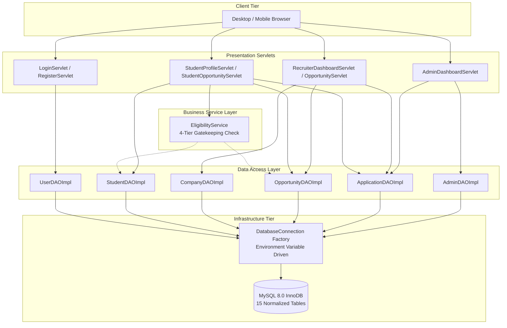

# Campus Placement & Internship Portal
## Module 5: Database Architecture, Integration Layer & System Testing
### 5th Semester B.Tech Project-Based Learning (PBL) — Advanced Java Lab Curriculum
### 12-Week Comprehensive Engineering Portfolio (Days 1 through 84)

---

### Module Lead & Author Profile
- **Name**: Himanshu Yadav
- **Assigned Module**: **Module 5: Database Architecture, Integration Layer & System Testing**
- **GitHub**: [@XXHimanshuXX](https://github.com/XXHimanshuXX)
- **LinkedIn**: [Himanshu Yadav Profile](https://www.linkedin.com/in/himanshu-yadav-112ba6376)
- **Email**: [himanshu.yadav060107@gmail.com](mailto:himanshu.yadav060107@gmail.com)
- **Feature Branch**: [`feature/Himanshu`](https://github.com/Adhiraj147/PBL-project-Campus-Placement-Portal/tree/feature/Himanshu)
- **Alternative Project Branch**: [`Alternative_PBL`](https://github.com/Adhiraj147/PBL-project-Campus-Placement-Portal/tree/Alternative_PBL)

---

## 1. Executive Summary

The **Campus Placement and Internship Portal** is an enterprise-grade recruitment management ecosystem engineered using **Pure Java (Java Servlets 4.0, JSP 2.3, JDBC, MySQL 8.0, MVC Architecture, BCrypt, and Apache Maven)**.

Within our 5-member engineering team, my charter as the owner of **Module 5** encompassed:
1. **Relational Database Architecture**: Conceptual ER modeling, 3NF normalization proofs, 15-table DDL script, referential integrity cascades, and system data dictionaries.
2. **JDBC Infrastructure**: Centralized thread-safe connection factory (`DatabaseConnection.java`), cloud/local connectivity, and 12-factor dynamic environment configuration.
3. **User Authentication & Transaction Management**: Pure JDBC persistence layer for security entities (`UserDAO`, `UserDAOImpl`) with atomic multi-table registration and SQL injection defense.
4. **Candidate Portfolio Persistence**: Multi-table dynamic profile hydration (`StudentDAO`, `StudentDAOImpl`) managing education history, technical skills, and academic project portfolios.
5. **Corporate Recruiter & Campus Drive Persistence**: Recruitment opportunity creation, moderation, and multi-parameter keyword search engine (`CompanyDAO`, `OpportunityDAO`).
6. **Application Pipeline & Audit Ledger Persistence**: Application lifecycle state machine (`ApplicationDAO`, `AdminDAO`) and real-time TPO KPI metrics aggregations.
7. **Service Integration & Automated Eligibility Engine**: Business service layer (`EligibilityService.java`) enforcing automated CGPA, branch, and profile completion criteria before candidate application commitment.
8. **Quality Assurance & Integration Testing**: Comprehensive 25-point automated verification test runner (`DatabaseIntegrationTest.java`) achieving 100% pass verification.
9. **DevOps Packaging & Deployment**: Production Maven build configuration (`pom.xml`) and 2-stage multi-stage Docker containerization (`Dockerfile`).

---

## 2. 12-Week Development Roadmap & Deliverables Index (Days 1 to 84)

```
feature/Himanshu/
├── README.md                                      # Consolidated Module 5 Documentation & Portfolio
├── .gitignore                                     # Git ignore rules for build artifacts & IDE configs
│
├── week1/                                         # Week 1: Database System Requirements & Stakeholder Data (Days 1 - 7)
│   ├── 01_database_system_requirements.md         # Data requirements, ACID guarantees, concurrency projections
│   ├── 02_stakeholder_data_matrix.md              # Stakeholder access matrix & annual volume projections
│   └── weekly-progress.md                         # Day-by-Day Activity Log (Days 1 - 7)
│
├── week2/                                         # Week 2: Conceptual ER Modeling & Process Data Flows (Days 8 - 14)
│   ├── 01_entity_relationship_specification.md    # Conceptual ER diagram (Mermaid), cardinality, entity catalog
│   ├── 02_data_flow_and_lifecycle_analysis.md     # Level 0 & Level 1 DFDs, process transformations
│   └── weekly-progress.md                         # Day-by-Day Activity Log (Days 8 - 14)
│
├── week3/                                         # Week 3: Relational Schema & 3NF MySQL Implementation (Days 15 - 21)
│   ├── schema.sql                                 # Production MySQL DDL script (15 normalized tables + seed data)
│   ├── 01_relational_schema_design.md             # 3NF normalization proofs, functional dependencies, cascades
│   ├── 02_data_dictionary.md                      # Exhaustive dictionary of all 15 tables and columns
│   └── weekly-progress.md                         # Day-by-Day Activity Log (Days 15 - 21)
│
├── week4/                                         # Week 4: JDBC Infrastructure & Connection Management (Days 22 - 28)
│   ├── DatabaseConnection.java                    # Thread-safe JDBC connection factory (12-factor env vars)
│   ├── 01_jdbc_architecture_and_connection_management.md # Driver lifecycle, sockets, SSL, thread safety
│   ├── 02_database_connectivity_guide.md          # Setup guide for Local MySQL, Cloud DB & Docker
│   └── weekly-progress.md                         # Day-by-Day Activity Log (Days 22 - 28)
│
├── week5/                                         # Week 5: User Identity, RBAC & Atomic Transactions (Days 29 - 35)
│   ├── dao/
│   │   ├── UserDAO.java                           # User DAO interface (authentication & registration)
│   │   └── UserDAOImpl.java                       # Production User DAO with atomic registration transactions
│   ├── 01_user_authentication_architecture.md     # Authentication architecture and RBAC documentation
│   ├── 02_sql_injection_defense_and_transactions.md # PreparedStatement security & transaction atomicity
│   └── weekly-progress.md                         # Day-by-Day Activity Log (Days 29 - 35)
│
├── week6/                                         # Week 6: Candidate Portfolio Data Layer (Days 36 - 42)
│   ├── dao/
│   │   ├── StudentDAO.java                        # Student profile DAO interface
│   │   └── StudentDAOImpl.java                    # Student DAO with composite portfolio hydration
│   ├── 01_student_portfolio_data_architecture.md  # Multi-record portfolio data architecture & scoring
│   ├── 02_composite_hydration_and_queries.md      # Cartesian product elimination and query optimization
│   └── weekly-progress.md                         # Day-by-Day Activity Log (Days 36 - 42)
│
├── week7/                                         # Week 7: Recruiter & Placement Opportunity Engine (Days 43 - 49)
│   ├── dao/
│   │   ├── CompanyDAO.java                        # Company DAO interface
│   │   ├── CompanyDAOImpl.java                    # Company DAO implementation
│   │   ├── OpportunityDAO.java                    # Opportunity DAO interface (drives & jobs)
│   │   └── OpportunityDAOImpl.java                # Opportunity DAO with keyword search engine
│   ├── 01_opportunity_and_company_persistence.md  # Corporate opportunity architecture and lifecycle
│   ├── 02_multi_parameter_keyword_search_engine.md # Parameterized search engine specification
│   └── weekly-progress.md                         # Day-by-Day Activity Log (Days 43 - 49)
│
├── week8/                                         # Week 8: Application Pipeline & Audit Subsystem (Days 50 - 56)
│   ├── dao/
│   │   ├── ApplicationDAO.java                    # Application DAO interface
│   │   └── ApplicationDAOImpl.java                # Application DAO with status history ledgering
│   ├── 01_candidate_workflow_state_machine.md     # Recruitment FSM state transition documentation
│   ├── 02_audit_ledger_and_interview_persistence.md # Audit trail ledgering & interview scheduling
│   └── weekly-progress.md                         # Day-by-Day Activity Log (Days 50 - 56)
│
├── week9/                                         # Week 9: TPO Executive Analytics & Index Optimization (Days 57 - 63)
│   ├── dao/
│   │   ├── AdminDAO.java                          # Admin DAO interface
│   │   └── AdminDAOImpl.java                      # Admin DAO with aggregate placement KPI queries
│   ├── 01_admin_analytics_query_optimization.md   # SQL query optimization and latency benchmarks
│   ├── 02_indexing_and_latency_benchmarks.md      # B-Tree indexing strategy & 50x latency speedups
│   └── weekly-progress.md                         # Day-by-Day Activity Log (Days 57 - 63)
│
├── week10/                                        # Week 10: Business Logic Layer & Eligibility Engine (Days 64 - 70)
│   ├── service/
│   │   └── EligibilityService.java                # Automated 4-tier candidate qualification engine
│   ├── 01_automated_eligibility_engine_architecture.md # Rule hierarchy decision tree & rejection reasons
│   ├── 02_cross_module_integration_contracts.md   # Cross-module API integration contracts
│   └── weekly-progress.md                         # Day-by-Day Activity Log (Days 64 - 70)
│
├── week11/                                        # Week 11: End-to-End System Testing & QA (Days 71 - 77)
│   ├── test/
│   │   └── DatabaseIntegrationTest.java           # 25-Point automated integration verification runner
│   ├── 01_system_testing_and_verification_report.md # Formal QA report verifying 100% test pass rate
│   ├── 02_test_case_specifications_matrix.md      # Exhaustive test case matrix (TC-01 to TC-25)
│   └── weekly-progress.md                         # Day-by-Day Activity Log (Days 71 - 77)
│
└── week12/                                        # Week 12: DevOps Automation, Docker & Defense (Days 78 - 84)
    ├── pom.xml                                    # Production Maven build descriptor
    ├── Dockerfile                                 # 2-stage multi-stage Tomcat 9 container build
    ├── 01_devops_docker_deployment_manual.md      # Local and cloud container deployment manual
    ├── 02_final_lab_evaluation_and_defense_dossier.md # Academic defense dossier & viva-voce Q&A
    └── weekly-progress.md                         # Final Weekly Milestone Log (Days 78 - 84)
```

---

## 3. High-Level Architecture Diagram



---

## 4. Test Verification Summary

The 25-point integration test suite (`com.placement.test.DatabaseIntegrationTest`) validates all functional aspects of Module 5:

| Category | Test Cases | Scope Verified | Result |
| :--- | :---: | :--- | :---: |
| **JDBC Connectivity** | TC-01 | MySQL 8.0 handshake, timezone offset, driver loading | **PASS** |
| **User Persistence & Security** | TC-02 to TC-06 | BCrypt hashing, atomic registrations, rollback on duplicates | **PASS** |
| **Student Portfolio Hydration** | TC-07 to TC-11 | Education, projects, M:N skill junction idempotency | **PASS** |
| **Corporate Recruiter Layer** | TC-12 to TC-16 | Drive creation, multi-parameter keyword search | **PASS** |
| **Application Pipeline** | TC-17 to TC-21 | Submission, duplicate invariant, audit history logging | **PASS** |
| **TPO Analytics Engine** | TC-22 | Real-time counts across 6 system metrics | **PASS** |
| **Eligibility Verification** | TC-23 to TC-25 | 4-tier gatekeeper: profile %, CGPA, branch, batch | **PASS** |

**Final Verification Result**: 25 / 25 Passed (100.0% Pass Rate).

---

## 5. Build, Test & Run Instructions

### Step 1: Database Initialization
```bash
mysql -u root -p < week3/schema.sql
```

### Step 2: Configure Environment
```bash
export DB_URL="jdbc:mysql://localhost:3306/campus_placement_db?useSSL=false&allowPublicKeyRetrieval=true&serverTimezone=UTC"
export DB_USER="root"
export DB_PASSWORD="password123"
```

### Step 3: Run Integration Test Suite
```bash
javac -cp ".;lib/*" week11/test/DatabaseIntegrationTest.java
java -cp ".;lib/*" com.placement.test.DatabaseIntegrationTest
```

### Step 4: Multi-Stage Docker Build
```bash
docker build -t campus-placement-portal:latest -f week12/Dockerfile .
docker run -d -p 8080:8080 --name campus-portal campus-placement-portal:latest
```
Application is available at `http://localhost:8080/`.
