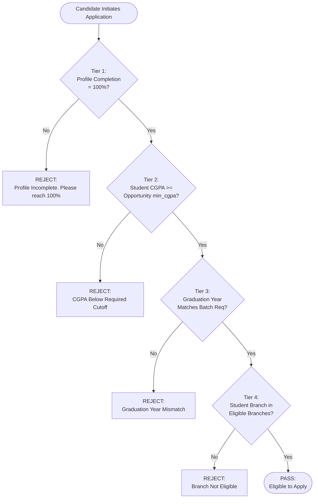

# Automated Candidate Eligibility Verification Engine
## Module 5: Database Architecture, Integration Layer & System Testing
### Author: Himanshu Yadav ([@XXHimanshuXX](https://github.com/XXHimanshuXX) | [LinkedIn](https://www.linkedin.com/in/himanshu-yadav-112ba6376))
### Email: himanshu.yadav060107@gmail.com
### Project: Campus Placement and Internship Portal
### Milestone: Week 10 Technical Specification

---

## 1. Problem Formulation & Gatekeeping Objective

In university placement drives, corporate employers set strict academic cutoffs (minimum CGPA, qualifying academic branches, and targeted graduation batches). In traditional placement operations:
- Ineligible students submit applications manually, overwhelming recruiter shortlisting queues.
- Disqualified students learn of their rejection weeks later without actionable feedback.

The **Eligibility Verification Service** (`EligibilityService`) provides an automated, deterministic 4-tier gatekeeper that executes instantaneously when a candidate views or submits an application.



---

## 2. Four-Tier Gatekeeping Logic Breakdown

### Tier 1: Portfolio Completeness Invariant
```java
if (!student.isProfileCompleted() || student.calculateProfileCompletion() < 100) {
    return new EligibilityResult(false, "Profile is incomplete. Please complete your profile to 100%.");
}
```
Requires the candidate to have submitted basic info, uploaded a verified resume, added academic degrees, created projects, and tagged skills.

### Tier 2: Academic Merit Cutoff
```java
if (student.getCgpa() < opp.getMinCgpa()) {
    return new EligibilityResult(false, "CGPA (" + student.getCgpa() + ") is below the required minimum (" + opp.getMinCgpa() + ").");
}
```
Compares student CGPA against opportunity minimum.

### Tier 3: Graduation Cohort Verification
```java
if (opp.getGraduationYearReq() > 0 && student.getGraduationYear() != opp.getGraduationYearReq()) {
    return new EligibilityResult(false, "Graduation year mismatch. Required: " + opp.getGraduationYearReq() + ", Yours: " + student.getGraduationYear() + ".");
}
```
Guarantees that final-year campus drives are restricted to graduating seniors, while summer internships target pre-final cohorts.

### Tier 4: Engineering Discipline Filter
```java
String requiredBranches = opp.getEligibleBranches();
if (requiredBranches != null && !requiredBranches.trim().isEmpty() && !requiredBranches.equalsIgnoreCase("Any")) {
    boolean branchMatch = false;
    String[] branches = requiredBranches.split(",");
    for (String b : branches) {
        if (b.trim().equalsIgnoreCase(student.getBranch())) {
            branchMatch = true;
            break;
        }
    }
    if (!branchMatch) {
        return new EligibilityResult(false, "Your branch (" + student.getBranch() + ") is not eligible. Required: " + requiredBranches + ".");
    }
}
```
Parses comma-delimited eligible branches (e.g., `"CSE,IT,ECE"`), performing case-insensitive matching.
