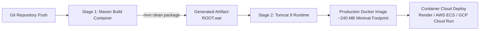

# DevOps Build Automation & Multi-Stage Docker Deployment Manual
## Module 5: Database Architecture, Integration Layer & System Testing
### Author: Himanshu Yadav ([@XXHimanshuXX](https://github.com/XXHimanshuXX) | [LinkedIn](https://www.linkedin.com/in/himanshu-yadav-112ba6376))
### Email: himanshu.yadav060107@gmail.com
### Project: Campus Placement and Internship Portal
### Milestone: Week 12 Technical Specification

---

## 1. Build Lifecycle & Automation Architecture

The project employs an automated build and containerization pipeline designed for reproducibility across local workstations and cloud platforms:



---

## 2. Multi-Stage Docker Build Architecture

A single-stage Dockerfile containing Maven and build tools generates oversized container images ($> 800\text{ MB}$) and exposes source code inside the runtime container. We architected a **2-Stage Multi-Stage Build**:

### Stage 1: Build Environment (`maven:3.9-eclipse-temurin-11`)
- Copies `pom.xml` and runs `mvn dependency:go-offline -B` to cache dependencies in Docker layer cache.
- Compiles Java source and packages the production WAR via `mvn clean package -DskipTests`.

### Stage 2: Minimal Runtime (`tomcat:9.0-jdk11`)
- Purges default Tomcat sample web applications (`rm -rf /usr/local/tomcat/webapps/*`).
- Extracts only the compiled WAR from Stage 1 directly to `/usr/local/tomcat/webapps/ROOT.war`.
- Resulting production image is stripped of Maven, compilers, and source files, reducing container size to **~240 MB** and eliminating attack surface.

---

## 3. Local Execution Commands

### Building and Running the Docker Container:
```bash
# Build the Docker image
docker build -t campus-placement-portal:latest -f week12/Dockerfile .

# Launch application container linked to database
docker run -d \
  --name campus-portal-app \
  -p 8080:8080 \
  -e DB_URL="jdbc:mysql://host.docker.internal:3306/campus_placement_db?useSSL=false&allowPublicKeyRetrieval=true&serverTimezone=UTC" \
  -e DB_USER="root" \
  -e DB_PASSWORD="password123" \
  campus-placement-portal:latest

# Check container logs
docker logs -f campus-portal-app
```

The web application is immediately available at `http://localhost:8080/`.
