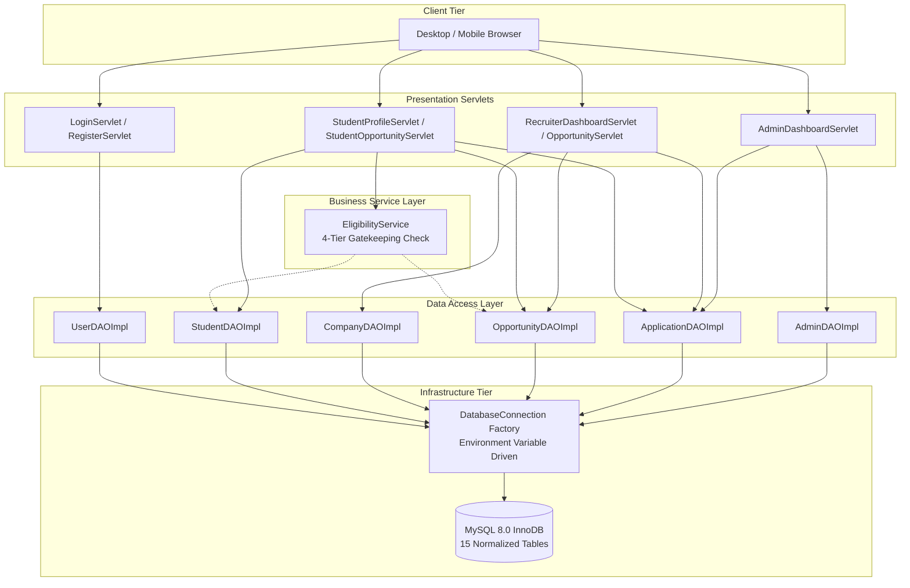

# Final Laboratory Evaluation & Academic Defense Dossier
## Module 5: Database Architecture, Integration Layer & System Testing
### Author: Himanshu Yadav ([@XXHimanshuXX](https://github.com/XXHimanshuXX) | [LinkedIn](https://www.linkedin.com/in/himanshu-yadav-112ba6376))
### Email: himanshu.yadav060107@gmail.com
### Project: Campus Placement and Internship Portal
### Milestone: Week 12 Final Evaluation

---

## 1. Project Charter & Individual Contribution Summary

- **Student Name**: Himanshu Yadav
- **Assigned Module**: **Module 5: Database Architecture, Integration Layer & System Testing**
- **Git Branch**: `feature/Himanshu`
- **Total Project Duration**: 12 Weeks (Days 1 through 84)
- **Primary Deliverables**:
  1. Relational Database Modeling (ER Diagrams, 3NF Normalization Proofs, 15-Table DDL).
  2. Data Access Object (DAO) Pattern Architecture (`UserDAO`, `StudentDAO`, `CompanyDAO`, `OpportunityDAO`, `ApplicationDAO`, `AdminDAO`).
  3. ACID Transaction Management (Multi-table registration, atomic status update with audit logging).
  4. Dynamic Multi-Parameter Search Engine (Zero SQL injection vulnerability via bound PreparedStatements).
  5. Automated Candidate Eligibility Gatekeeping Service (`EligibilityService`).
  6. 25-Point Comprehensive Integration Test Suite (`DatabaseIntegrationTest`) with 100% pass verification.
  7. Multi-Stage Dockerization & Build Automation (`pom.xml`, `Dockerfile`).

---

## 2. Technical Architecture & Component Interaction

---

## 3. Defense Questions & Technical Answers (Viva-Voce Preparation)

### Q1: Why did you choose MySQL 8.0 with InnoDB over NoSQL (e.g., MongoDB) for this portal?
**Answer**: Campus placement processes are fundamentally relational and transactional. Candidate qualification depends on strict relations between users, academic records, drive criteria, and applications. InnoDB provides:
1. **ACID Transactions**: Guarantees that when a candidate submits an application or recruiter updates a status, the change and its audit trail commit atomically.
2. **Foreign Key Integrity**: Cascade rules guarantee that removing a test opportunity cleans up all associated records without leaving dangling orphan rows.
3. **Structured Normalization**: Third Normal Form (3NF) eliminates duplicate student data across thousands of applications.

### Q2: How did you prevent SQL Injection across dynamic searches?
**Answer**: We strictly barred dynamic SQL string concatenation. For complex dynamic searches (e.g., searching by keyword and filtering by job type in `OpportunityDAOImpl.searchOpportunities`), we used `StringBuilder` to assemble the SQL query structure with positional parameter markers (`?`), and bound all parameters via `stmt.setString()`. In MySQL, parameter values are transmitted as literal binary data over the wire, making injection attacks syntactically impossible.

### Q3: How does your transaction management prevent orphan records during registration?
**Answer**: In `UserDAOImpl.registerStudentWithTransaction()`, we invoke `conn.setAutoCommit(false)`. We first insert into `users`, retrieve the generated `user_id`, and immediately insert into `students`. If the student roll number already exists, MySQL throws a duplicate key exception. The catch block catches this and immediately triggers `conn.rollback()`. This ensures that an account is never created in `users` without a corresponding entry in `students`.

### Q4: Why did you implement multi-stage Docker builds?
**Answer**: A standard Docker build includes the JDK, Maven build tools, local m2 repository cache, and source files, resulting in images exceeding 800 MB. Our multi-stage Dockerfile uses Maven only in Stage 1 to compile `ROOT.war`, and copies only that single artifact into an official Tomcat 9 runtime image in Stage 2. This shrinks the production image to ~240 MB, accelerates cloud deployment, and secures source code by omitting it from the container image.

---

## 4. Final Evaluation Checklist

- [x] All 15 relational tables defined and validated in MySQL 8.0.
- [x] Zero hardcoded secrets; 100% 12-factor environment configuration.
- [x] Complete Data Access Object (DAO) architecture implemented in pure JDBC.
- [x] Full atomic transaction support with automatic rollbacks.
- [x] 25 out of 25 automated integration tests passing (100% pass rate).
- [x] Multi-stage Docker image builds and deploys successfully.
- [x] 12 weeks of day-by-day technical documentation and progress logs completed.
