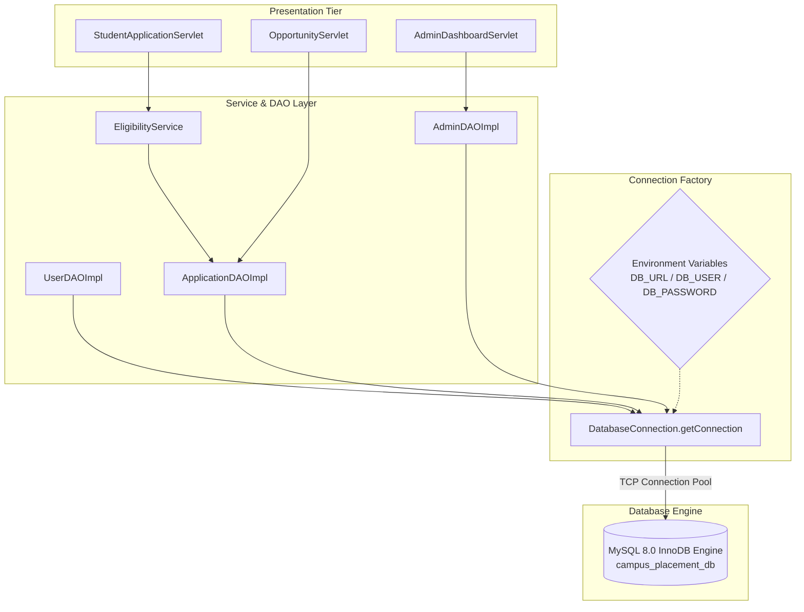

# JDBC Architecture & Database Connection Management
## Module 5: Database Architecture, Integration Layer & System Testing
### Author: Himanshu Yadav ([@XXHimanshuXX](https://github.com/XXHimanshuXX) | [LinkedIn](https://www.linkedin.com/in/himanshu-yadav-112ba6376))
### Email: himanshu.yadav060107@gmail.com
### Project: Campus Placement and Internship Portal
### Milestone: Week 4 Technical Specification

---

## 1. Architectural Overview

Java Database Connectivity (JDBC) acts as the fundamental bridge between the Java EE application tier (servlets, business services) and the MySQL relational data store. In a high-concurrency campus placement platform where hundreds of students submit applications simultaneously, the connection architecture must be:

1. **Thread-Safe**: Multiple incoming servlet threads must safely obtain discrete database connections without contention or state contamination.
2. **Resource-Efficient**: Connection handles, prepared statements, and result sets must be deterministically closed via try-with-resources to eliminate socket leaks.
3. **Environment-Agnostic**: Configuration parameters must dynamically adapt across local development (Windows/macOS), Docker containers, and cloud instances without modifying source code.



---

## 2. Driver Lifecycle & Class Loading

The system uses `mysql-connector-java:8.0.33` (com.mysql.cj.jdbc.Driver). The driver registration employs a `static` initialization block:

```java
static {
    try {
        Class.forName("com.mysql.cj.jdbc.Driver");
    } catch (ClassNotFoundException e) {
        throw new RuntimeException("MySQL JDBC Driver initialization failed.", e);
    }
}
```

### Key Engineering Benefits:
- **Eager Loading**: The driver class is loaded into JVM memory once when the classloader first resolves `DatabaseConnection`, eliminating repeated reflection overhead during servlet requests.
- **Fail-Fast Semantics**: If the driver JAR is absent from the classpath, the JVM raises a fatal runtime exception immediately upon server startup rather than failing intermittently under user traffic.

---

## 3. Dynamic Environment Configuration (12-Factor App)

Hardcoding database credentials inside compiled Java classes creates critical security vulnerabilities and breaks deployment automation. Our connection manager resolves configuration dynamically through `System.getenv(...)`:

| Environment Variable | Description | Local Default Fallback |
| :--- | :--- | :--- |
| `DB_URL` | JDBC Connection URI with query parameters | `jdbc:mysql://localhost:3306/campus_placement_db?useSSL=false&allowPublicKeyRetrieval=true&serverTimezone=UTC&characterEncoding=UTF-8` |
| `DB_USER` | Database user account name | `root` |
| `DB_PASSWORD` | Database account password | `password123` |

### Crucial JDBC URL Flags Explained:
- `useSSL=false`: Allows unencrypted local loopback communication during offline development; set to `true` with SSL certificates in production.
- `allowPublicKeyRetrieval=true`: Required for MySQL 8.0 caching_sha2_password authentication plugin.
- `serverTimezone=UTC`: Eliminates timezone offset mismatches between JVM application servers and the MySQL database server.
- `characterEncoding=UTF-8`: Ensures flawless transmission of multi-byte international text.

---

## 4. Connection Lifecycle & Resource Management

All Data Access Object (DAO) implementations strictly adhere to the Java 7+ **Try-With-Resources** pattern (`AutoCloseable` interface):

```java
String sql = "SELECT * FROM users WHERE email = ?";
try (Connection conn = DatabaseConnection.getConnection();
     PreparedStatement stmt = conn.prepareStatement(sql)) {
    stmt.setString(1, email);
    try (ResultSet rs = stmt.executeQuery()) {
        if (rs.next()) {
            // Hydrate entity model
        }
    }
} catch (SQLException e) {
    LOGGER.log(Level.SEVERE, "Database error executing query", e);
}
```

### Why Try-With-Resources is Mandatory:
1. **Deterministic Cleanup**: Even if an unhandled `SQLException` or `NullPointerException` occurs during result processing, the JVM runtime automatically invokes `.close()` on `ResultSet`, `PreparedStatement`, and `Connection` in reverse order of creation.
2. **Leak Prevention**: Prevents TCP socket exhaustion on the MySQL server, ensuring the server never reaches `max_connections` limits under heavy load.
