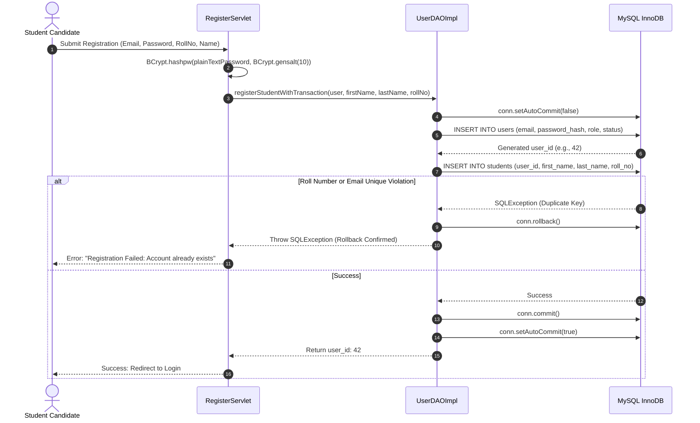

# User Authentication & Role Authorization Architecture
## Module 5: Database Architecture, Integration Layer & System Testing
### Author: Himanshu Yadav ([@XXHimanshuXX](https://github.com/XXHimanshuXX) | [LinkedIn](https://www.linkedin.com/in/himanshu-yadav-112ba6376))
### Email: himanshu.yadav060107@gmail.com
### Project: Campus Placement and Internship Portal
### Milestone: Week 5 Technical Specification

---

## 1. System Authentication Overview

The user identity layer serves as the single source of truth for authenticating students, corporate recruiters, and placement administrators. A primary engineering goal of Module 5 was to decouple authentication credentials from role-specific profile attributes while guaranteeing atomic account creation.



---

## 2. Password Hashing with Adaptive BCrypt

Passwords are never stored in plaintext. The system incorporates OpenBSD-standard **BCrypt** with an adaptive work factor of `10`:

```java
// Password Hashing at Registration
String hashedPassword = BCrypt.hashpw(rawPassword, BCrypt.gensalt(10));

// Verification at Authentication
boolean matches = BCrypt.checkpw(candidatePassword, storedPasswordHash);
```

### Security Benefits of BCrypt:
- **Salt Inclusion**: BCrypt automatically embeds a cryptographically secure 128-bit pseudo-random salt in the resultant hash string, thwarting precomputed rainbow table attacks.
- **Adaptive Cost Factor**: The iteration count is configurable ($2^{10} = 1024$ rounds), allowing future computational scaling against specialized GPU brute-force attacks.

---

## 3. Atomic Multi-Table Registration Transactions

When a student registers, two interrelated records must be written:
1. `users`: Credentials, role (`STUDENT`), and activation status.
2. `students`: Academic metadata (`roll_no`, `first_name`, `last_name`).

If the student profile insertion fails (e.g., the student's university roll number already exists in `students`), leaving the credentials in `users` would create an "orphaned user" who cannot log in or re-register with their roll number.

### Transactional Guarantees:
- `conn.setAutoCommit(false)` initiates an atomic transaction block.
- If any statement throws an `SQLException`, the `catch` block invokes `conn.rollback()`.
- The connection is cleanly reset via `conn.setAutoCommit(true)` and closed inside the `finally` block.
- Result: **Zero orphan records**.
