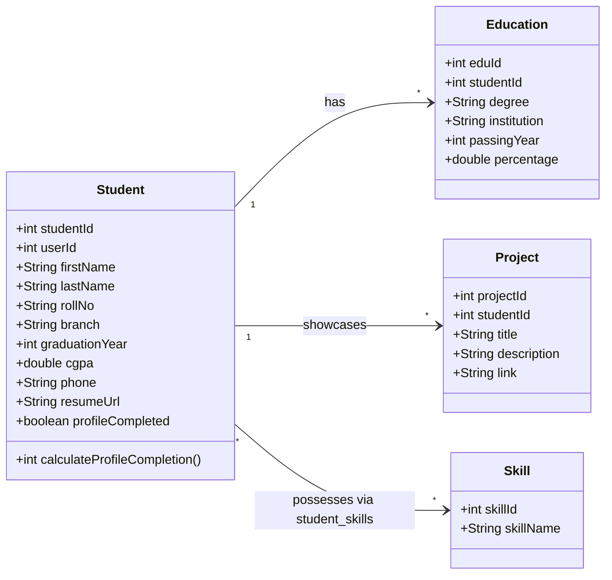

# Student Candidate Profile & Portfolio Data Architecture
## Module 5: Database Architecture, Integration Layer & System Testing
### Author: Himanshu Yadav ([@XXHimanshuXX](https://github.com/XXHimanshuXX) | [LinkedIn](https://www.linkedin.com/in/himanshu-yadav-112ba6376))
### Email: himanshu.yadav060107@gmail.com
### Project: Campus Placement and Internship Portal
### Milestone: Week 6 Technical Specification

---

## 1. Candidate Domain Architecture

A candidate student's profile is not a flat record; it is a rich composite portfolio consisting of:
1. **Core Demographics & Academics**: Name, roll number, department/branch, graduation batch, CGPA, verified PDF resume link.
2. **Academic Degrees**: Historical 10th, 12th, and Diploma/Undergraduate metrics (`education`).
3. **Engineering Projects**: Title, description, and source repository/live demo URLs (`projects`).
4. **Normalized Skill Tags**: Many-to-many relationship linking candidates with standardized competency tags (`skills`, `student_skills`).

---

## 2. Dynamic Profile Completion Scoring Algorithm

In order for students to be eligible to apply for high-value campus placement drives, they must reach a **100% complete profile**. The `Student` domain model encapsulates this evaluation:

$$\text{Score} = \sum w_i$$

Where:
- Basic info (`phone`, `branch`, `cgpa`, `graduation_year`): **20%**
- Resume link provided (`resume_url`): **20%**
- Education records present ($\ge 1$ entries): **20%**
- Projects showcased ($\ge 1$ entries): **20%**
- Technical skills registered ($\ge 1$ entries): **20%**

Total maximum score = **100%**.
The persistence layer automatically sets `profile_completed = true` upon basic profile submission, enabling fast indexing.
