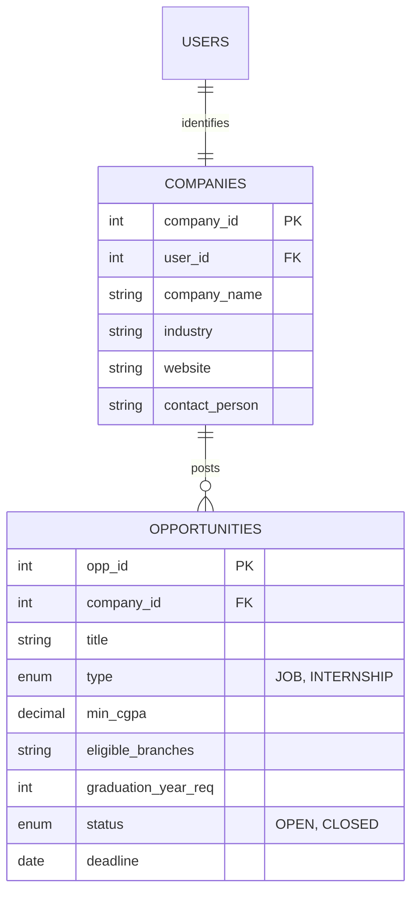

# Recruiter Company & Placement Opportunity Persistence
## Module 5: Database Architecture, Integration Layer & System Testing
### Author: Himanshu Yadav ([@XXHimanshuXX](https://github.com/XXHimanshuXX) | [LinkedIn](https://www.linkedin.com/in/himanshu-yadav-112ba6376))
### Email: himanshu.yadav060107@gmail.com
### Project: Campus Placement and Internship Portal
### Milestone: Week 7 Technical Specification

---

## 1. Domain Modeling of Corporate Placement Drives

The recruiter persistence layer manages two tightly coupled domain objects:
1. **Company (`companies`)**: Corporate entity profile containing employer branding, industry domain, website, primary contact person, and location.
2. **Opportunity (`opportunities`)**: Specific recruitment initiatives, categorized as either `JOB` (full-time placement) or `INTERNSHIP`.

---

## 2. Referential Integrity & Opportunity Lifecycle

Placement drives exist within a defined lifecycle:
- **`OPEN`**: Active and accepting candidate applications.
- **`CLOSED`**: Concluded by the recruiter or passed deadline.

When a corporate partner updates drive criteria (e.g., modifying `min_cgpa` or extending `deadline`), `OpportunityDAOImpl.updateOpportunity()` executes an atomic update guarded by primary key `opp_id`.

If a company account is removed by administrators, MySQL's `ON DELETE CASCADE` constraint on `opportunities.company_id` automatically sweeps all associated postings and child applications, preventing orphaned recruitment drives.
