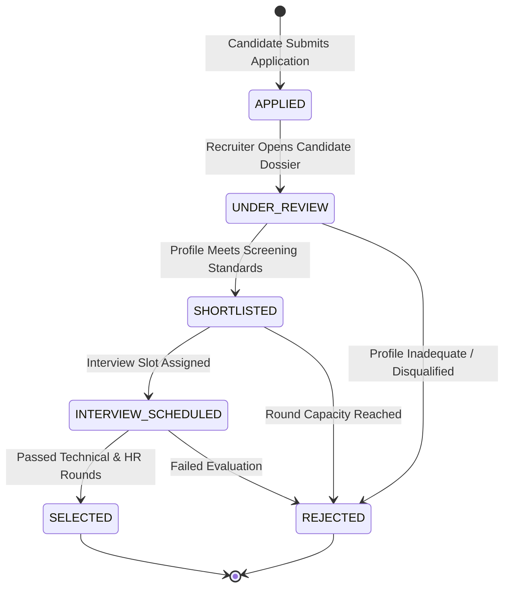

# Candidate Recruitment Workflow State Machine
## Module 5: Database Architecture, Integration Layer & System Testing
### Author: Himanshu Yadav ([@XXHimanshuXX](https://github.com/XXHimanshuXX) | [LinkedIn](https://www.linkedin.com/in/himanshu-yadav-112ba6376))
### Email: himanshu.yadav060107@gmail.com
### Project: Campus Placement and Internship Portal
### Milestone: Week 8 Technical Specification

---

## 1. Recruitment Pipeline State Machine

Every student application transitions through a deterministic finite state machine (FSM). Valid transitions are restricted to enforce process integrity across corporate selection rounds.

---

## 2. State Transition Rules & Constraints

| Current State | Target State | Permitted Initiator | Trigger Event & Database Action |
| :--- | :--- | :--- | :--- |
| `[None]` | `APPLIED` | Student | Candidate clicks Apply; verified by `EligibilityService` and `hasApplied()` check. |
| `APPLIED` | `UNDER_REVIEW` | Recruiter / Admin | Recruiter inspects candidate dossier and resume. |
| `UNDER_REVIEW` | `SHORTLISTED` | Recruiter | Candidate clears initial resume screening. |
| `SHORTLISTED` | `INTERVIEW_SCHEDULED` | Recruiter / Admin | Interview round created in `interviews` table; status updated. |
| `INTERVIEW_SCHEDULED`| `SELECTED` | Recruiter | Final offer issued to candidate. |
| Any Active State | `REJECTED` | Recruiter / Admin | Candidate eliminated with rejection remarks stored in history. |

---

## 3. Duplicate Prevention Architecture

To prevent race conditions where a candidate clicks the submit button multiple times, protection exists at two independent layers:
1. **Application Layer Pre-Check**: `ApplicationDAO.hasApplied(studentId, oppId)` performs an indexed existence query (`SELECT 1 FROM applications WHERE student_id = ? AND opp_id = ?`).
2. **Database Engine Enforced Invariant**: Composite unique key `UNIQUE KEY uq_student_opportunity (student_id, opp_id)` guarantees that even under simultaneous concurrent HTTP threads, MySQL rejects duplicate inserts at the storage engine level.
